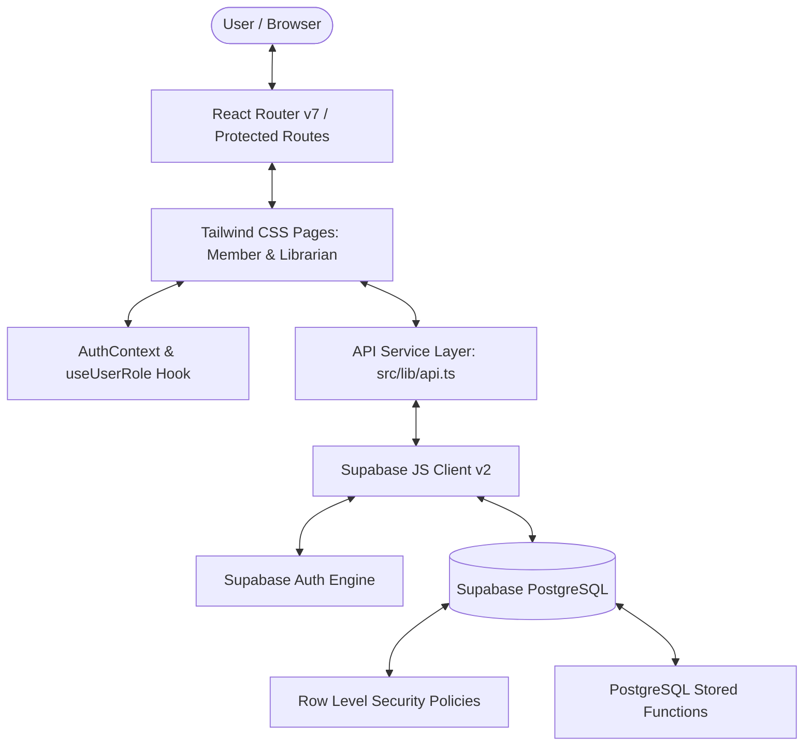

# Library Lending Management System

A full-stack, responsive, and secure Library Lending Management System built with **React 19**, **Vite**, **TypeScript**, **Tailwind CSS v4**, and **Supabase (PostgreSQL & Supabase Auth)**.

---

## 1. Project Overview & Problem Statement

Libraries face recurring operational challenges managing inventory, handling concurrent borrows of limited physical copies, managing queue priorities for high-demand titles, calculating daily overdue penalties, and administering global lending rules. 

The **Library Lending Management System** solves these challenges through:
- A transactional PostgreSQL database architecture with **Row Level Security (RLS)**.
- Secure PostgREST **Remote Procedure Calls (RPC)** enforcing concurrency locks (`SELECT ... FOR UPDATE`), transaction safety, and fine cap logic.
- A modern, responsive single-page web application featuring role-based dashboards for **Members** and **Librarians**.

---

## 2. Project Objectives

- **Transactional Integrity**: Prevent race conditions (such as double checkout of the last available book copy) via database-level transactional locks.
- **Role-Based Access Control (RBAC)**: Strict segregation between patron (Member) capabilities and administrative (Librarian) controls across both UI routing and database policies.
- **Reservation Queuing (FIFO)**: Automatic queue tracking when book copies are exhausted, allowing members to hold priority positions.
- **Overdue & Penalty Automation**: Systematic fine calculation based on configurable daily rates and fine caps.
- **Configurable Policies**: Real-time management of loan periods, fine caps, borrowing thresholds, and hold durations without code modifications.

---

## 3. Technology Stack

- **Frontend**:
  - React 19 + TypeScript
  - Vite (Build Tool & Dev Server)
  - Tailwind CSS v4
  - React Router v7
- **Backend & Database**:
  - Supabase PostgreSQL
  - Supabase Auth (Email & Password authentication with session management)
  - Supabase JS v2 Client
- **Testing**:
  - Vitest + JSDOM
  - Unit & Integration Test Suite

---

## 4. System Architecture



---

## 5. Database Schema & Tables

| Table | Description | Access Rules (RLS) |
|---|---|---|
| `profiles` | Stores user role (`member` or `librarian`), full name, and email | Users can view/update own profile; librarians can view all |
| `books` | Book catalog: `title`, `author`, `isbn`, `total_copies`, `available_copies` | Public read; write restricted to `librarian` via RPC |
| `loans` | Borrow records: `book_id`, `user_id`, `borrowed_at`, `due_date`, `returned_at` | Members read own loans; librarians read all; return via RPC |
| `reservations` | Holds queue: `book_id`, `user_id`, `position`, `status`, `created_at` | Members view own queue position; librarians view all |
| `fines` | Overdue penalty tracking: `loan_id`, `user_id`, `amount`, `paid`, `created_at` | Members view own fines; librarians record payments |
| `library_settings` | Key-value store for global rules (`loan_period_days`, `fine_per_day`, etc.) | Read permitted to all; updates restricted to `librarian` |

---

## 6. Role-Based Feature Matrix

### Member Features
- **Dashboard**: High-level KPI widgets displaying active borrowed books, active reservations, and total unpaid fines.
- **Browse & Search Catalog**: Real-time search by title or author with live availability counts.
- **Checkout**: Direct borrowing of available copies (`available_copies > 0`).
- **Reservations**: Queue placement for unavailable titles with automated FIFO position tracking.
- **My Loans**: Detailed record of currently borrowed titles, checkout timestamps, and overdue alerts.
- **My Fines**: View fine breakdowns and payment statuses.
- **Account Details**: Profile view and full name updates.

### Librarian Features
- **Librarian Dashboard**: System-wide overview of total titles, active checked-out copies, and pending fines.
- **Manage Books**: Add new catalog entries, update metadata (titles, authors, ISBNs, descriptions, copies).
- **Manage Copies**: Increment copy quantities for existing inventory.
- **All Loans**: Comprehensive audit log of all patron checkouts, returns, and overdue dates.
- **Process Returns**: Check in physical returns, trigger automated fine calculations, and release copy availability.
- **Fine Payments**: Record settlements for outstanding patron fines.
- **Library Settings**: Configure:
  1. `loan_period_days` (default loan duration)
  2. `fine_per_day` (daily penalty rate)
  3. `fine_cap` (maximum fine ceiling per loan)
  4. `max_active_loans` (maximum concurrent books per member)
  5. `reservation_hold_period_days` (hold duration before expiry)
  6. `borrowing_threshold` (unpaid fine ceiling blocking new checkouts)

---

## 7. Business Logic & Stored Functions (RPC)

All core business mutations are executed via database RPCs to eliminate race conditions and enforce permission constraints:

- `create_book(title, author, isbn, description, total_copies)`: Creates a book entry.
- `update_book(id, title, author, isbn, description, total_copies)`: Edits existing catalog records.
- `add_book_copies(book_id, count)`: Safely increments total and available copies.
- `checkout_book(book_id, user_id)`:
  - Enforces member loan limits (`max_active_loans`).
  - Verifies unpaid fine status does not exceed `borrowing_threshold`.
  - Atomically locks book row (`FOR UPDATE`), checks `available_copies > 0`, decrements inventory, and creates a loan.
  - Fulfills reservation if user was first in queue.
- `process_book_return(loan_id)`:
  - Marks loan `returned_at`.
  - Calculates overdue days past `due_date`.
  - Computes fine based on `fine_per_day` and caps at `fine_cap`.
  - Increments book `available_copies` and advances reservation queue.
- `reserve_book(book_id, user_id)`:
  - Verifies no available copies exist.
  - Inserts user into `reservations` table with next sequential FIFO `position`.
- `refresh_reservation_queue(book_id)`:
  - Evaluates expired holds and promotes the next eligible reservation in FIFO order.
- `record_fine_payment(fine_id)`:
  - Marks fine as paid (`paid = true`).
- `update_library_setting(setting_key, setting_value)`:
  - Enforces librarian credentials and updates configuration table.

---

## 8. Reservation Expiry & Promotion Limitations

> [!NOTE]
> **Reservation Hold Expiry Mechanism**:
> PostgreSQL does not include an internal daemon cron scheduler unless an extension such as `pg_cron` is enabled or an external webhook/worker regularly calls `refresh_reservation_queue`. In this deployment, the `refresh_reservation_queue` stored procedure handles reservation expiration and promotion on-demand. When `pg_cron` or Supabase Edge Functions are connected, this procedure should be scheduled to run at regular intervals (e.g., hourly).

---

## 9. Security & RLS Principles

- **Row Level Security (RLS)** is enabled on all tables (`books`, `loans`, `reservations`, `fines`, `profiles`, `library_settings`).
- **No Service-Role Key**: The frontend exclusively uses the Supabase Anonymous publishable key (`VITE_SUPABASE_ANON_KEY`).
- **Session Verification**: Authenticated JWT tokens issued by Supabase Auth are transmitted with every request; role claims are verified directly in PostgreSQL through the `profiles` table.

---

## 10. Environment Configuration

Create a `.env` file in `library-lending-frontend/` with your Supabase credentials:

```env
VITE_SUPABASE_URL=https://<your-supabase-project-id>.supabase.co
VITE_SUPABASE_ANON_KEY=<your-supabase-anon-key>
```

---

## 11. Installation & Running Locally

### Prerequisites
- Node.js (v18 or higher)
- npm or yarn

### Steps
1. Navigate to the frontend directory:
   ```bash
   cd library-lending-frontend
   ```
2. Install dependencies:
   ```bash
   npm install
   ```
3. Start the development server:
   ```bash
   npm run dev
   ```
4. Access the web interface at `http://localhost:5173`.

---

## 12. Automated Testing

The project includes 14 comprehensive unit and integration tests covering route protection, search, reservations, fine calculation, fine caps, duplicate payments, and concurrency locks:

Run the test suite:
```bash
npm test
```

### Verified Test Cases:
1. Librarian route protection (permits librarian roles)
2. Member route protection (blocks member access to staff routes)
3. Unauthenticated route protection (redirects guests to `/login`)
4. Book search filtering by query
5. Checkout eligibility based on available copies
6. Maximum active loan restrictions
7. Reservation creation with RPC payload verification
8. FIFO reservation queue ordering
9. Reservation expiry & queue promotion RPC integration
10. Accurate overdue fine calculation
11. Fine cap ceiling enforcement
12. Duplicate fine payment prevention
13. Librarian-only library settings updates
14. Prevention of concurrent checkout of exhausted copies

---

## 13. Production Build

To compile TypeScript and create the production-ready distribution:

```bash
npm run build
```

The output will be generated inside the `dist/` directory.

---

## 14. License
MIT License.
